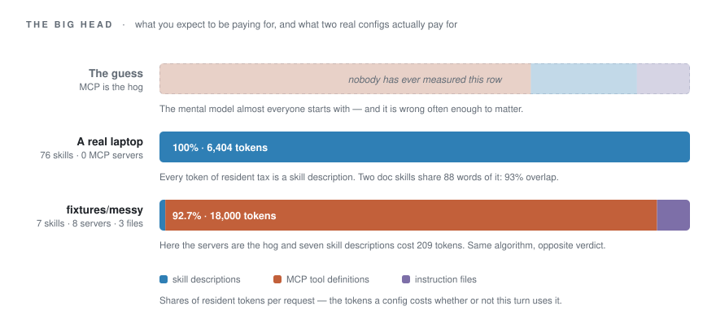

<h1 align="center">context-tax</h1>

<p align="center">
  <a href="https://github.com/Romantic-haitang/context-tax/actions/workflows/ci.yml"></a>
  
  
  
</p>

<p align="center"><b>Your agent config pays rent on every turn. This prints the bill.</b></p>

Skill descriptions, MCP tool definitions, `CLAUDE.md` — the same bytes go out with **every** request, whether or not this turn touches them. Nobody notices at three skills. By the tenth skill and the seventh MCP server you are holding 10–20% of your context permanently in reserve for tasks that may never arrive, and paying for it on every single call.

`context-tax` is not another SKILL.md linter. It counts money and window: **what your idle config costs per turn, and which lines on that bill you can actually get refunded.**

<picture>
  <source media="(prefers-color-scheme: dark)" srcset="assets/context-tax-dark.svg">
  
</picture>

## Three real runs

### 1. This laptop: 76 skills, not a single MCP server

| | |
| --- | --- |
| Resident tax | **6,404 tokens per request** — 3.2% of the window |
| Where it goes | 76 skill descriptions, **100%**. Zero MCP servers, zero instruction files |
| Cost | ~$8.07/mo at 1,500 requests, $3/M input, 80% cache hits ($28.82 with no cache) |
| Reclaimable | 4% (247 tokens) — this machine is not a money problem |
| Trigger tax | 186,840 tokens across the 76 skill bodies |
| Findings | 1 critical, 5 warnings, 1 info |

Three things it found:

**1. Skill descriptions are the entire bill.** 76 of them, 6,404 tokens, 100% of resident tax. The folk wisdom says "MCP servers are what eat your context" — on this machine there is no MCP server configured at all, and the tax is still there. Every one of those descriptions is a paragraph you re-buy 1,500 times a month.

**2. Two doc skills are fighting over the same trigger.** `tencent-docs` and `tencent-saas-docs` share 88 content words — 93% overlap. Merging them saves 171 tokens. Ignore the 171. The actual damage is that on every "open the spreadsheet" request the model flips a coin between a personal and an enterprise product. You thought you were installing a backup; you installed a coin flip.

**3. 27 skills exist in two directories, and two pairs have already drifted.** Duplicates don't double the bill — only one copy loads at runtime — so the tool refuses to charge you twice for them. What they do produce is two harnesses that quietly answer differently, because you edited one copy and forgot the other.

### 2. `fixtures/messy`: eight servers, the opposite answer

Reproducible from the repo, so you can check the arithmetic yourself.

| | |
| --- | --- |
| Resident tax | **19,419 tokens per request** — 9.7% |
| Where it goes | 8 MCP servers **92.7%**, 3 instruction files 6.2%, 7 skills 1.1% |
| Cost | ~$24.47/mo ($87.39 with no cache) |
| Reclaimable | **49% ≈ 9,572 tokens**, about $12.06/mo |
| Findings | 1 critical, 4 warnings, 2 info |

Here the servers really are the hog: 18,000 tokens of tool definitions injected before the model reads a word of your actual task. The seven skills cost 209 tokens together — a rounding error. Same code, same thresholds, opposite verdict.

That is the whole lesson. **"Which kind of config is expensive" has no answer in general, only an answer on your machine.** Run it instead of arguing about it.

### 3. A project directory: 0.1% resident tax, 8,060 tokens of trigger tax

| | |
| --- | --- |
| Resident tax | **101 tokens** — 0.1%, effectively free |
| Trigger tax | **8,060 tokens** the moment either skill is picked |
| Findings | 0 critical, 1 warning, 1 info |

Two skills, 13KB and 20KB, single files, no `references/`. Nothing is paid per turn — everything is paid **once**, in full, on the turn the model decides to load them. A 20,000-word SOP lands in the window and your actual question gets the leftover attention.

Resident tax and trigger tax are two different bills. Add them together and you conclude "my config is clean". Keep them apart and you find the 8,000-token landmine sitting behind a 0.1%.

Two honest footnotes on this one. The directory holds 15,393 files and 564MB of chat exports, and no `CLAUDE.md`, no MCP — it scores well because **it is barely configured**, not because it is well configured. And one skill's frontmatter says `name: qimen-duanjua` while its directory says `qimen-dunjia`; the host resolves by name, the UI shows the directory, so the name you see is the name that doesn't work.

## Run it

No install, no dependencies, Python 3.9+:

```bash
git clone https://github.com/Romantic-haitang/context-tax && cd context-tax
python3 -m context_tax /path/to/your/project
```

Include your global config (`~/.claude`, `~/.agents`, `~/.codex`, `~/.cursor`, `~/.workbuddy`):

```bash
python3 -m context_tax . --global
```

Include the skills your host ships with — **this is usually where the body count is**:

```bash
python3 -m context_tax . --global --plugins
```

Without `--plugins`, the report says out loud how many plugin skills it left out. Better a bill with a visible hole in it than a clean-looking one you trust too much.

Put your own prices in, or the dollar figures are just decoration:

```bash
python3 -m context_tax . --requests 3000 --price 15
```

Fail CI when the tax rate crosses a line:

```bash
python3 -m context_tax . --fail-over 0.12
```

Other flags: `--json`, `--md`, `--window`, `--cache-hit`, `--no-color`, `-v`. How the numbers are derived: `python3 -m context_tax explain`.

The CLI speaks Chinese today. `--json` is language-neutral if you need to parse it — an English UI is on the list, not in the code.

## What it checks

| Check | What it means |
| --- | --- |
| `mcp-flood` | Number of MCP servers and the size of their tool definitions |
| `instruction-duplicate` | `CLAUDE.md` / `AGENTS.md` saying the same thing (the classic multi-harness tax) |
| `instruction-bloat` | Resident instructions long enough to dilute each other |
| `skill-overlap` | Two skills competing for the same trigger words |
| `skill-multi-copy` | One skill stored in several harness directories, drifting apart |
| `skill-unreachable` | Missing or too-short description — the model will never find it |
| `skill-generic` | Descriptions full of "various / any / helps with" that fire everywhere |
| `skill-no-disclosure` | Body over 3,000 tokens with no `references/` directory |
| `skill-thin` | Under 60 tokens of body — that's a sticky note, not a skill |
| `skill-name-mismatch` | Frontmatter `name` disagrees with the directory name |
| `skill-stale` | Untouched for 180+ days and probably describing an older world |

`skill-overlap` has two edges worth writing down, so you don't get fooled by your own tool:

- **Short descriptions are not judged.** After stopword removal, a description with fewer than 4 content words makes too small a set to score. Two "Use this skill to create X" strings share one word and score 100% — that's arithmetic, not evidence.
- **Wildly different sizes are not judged.** `overlap_coefficient` divides by the smaller set, so 3 words against 77 also scores 100%. Above a 3× size ratio the metric is discarded.

This tool would rather miss a real collision than hand you 55 alerts where a skill is fighting itself.

## Why a tax rate and not a score

Any score can be gamed by a clever weighting scheme. A tax rate has exactly one definition: **the percentage of your window you pay each turn for things you don't need.** There's nothing to argue with.

It is also not pretending to be a quality grade. A 3% config can be all filler; a 12% config can be earning every token. This tool does the bookkeeping. Whether the work is any good is still your problem.

## Where it is allowed to be wrong

- **Read-only.** It never edits your files. No "I fixed it for you" surprises.
- **Estimated, not measured.** Tokens are CJK 0.75/char and ASCII 0.25/char, roughly ±8%; MCP is estimated at 15 tools × 150 tokens per server. Good enough to decide what to delete, not good enough to file an invoice.
- **It does not observe your traffic.** `--requests` is a number you supply, not a number it saw.
- **Caching is already priced in.** Default assumes 80% cache hits at 0.1× list price, which is why the monthly savings look smaller than the ones other tools advertise. That's the correct direction to be wrong in.
- **Duplicate copies are charged once.** Three copies in three harness directories still only load once, so they're reported separately and don't inflate the bill.
- **`--plugins` is a ceiling.** Skills sitting in a plugin cache may not all be enabled, so this is "at most this much", not "exactly this much".
- **`skill-stale` depends on dates, and mtimes lie in both directions.** A fresh clone, a CI run, a Docker image — every file's mtime becomes the checkout time, so every skill looks edited today. It therefore prefers `updated:` in the frontmatter (also accepts `last-updated` / `modified` / `reviewed` / `date`) and only falls back to mtime. The other lie is worse: plugin archives that ship `mtime = 0` once produced the line "oldest: create-pet, 20753 days". An mtime before 1990 is now treated as unknown rather than as 56 years of neglect. `evals/run.py` asserts both directions, because git can't carry mtimes and fixtures can't reproduce this.
- **A high grade with a critical finding still says so.** The grade is pure arithmetic — 3.2% is 3.2% — but the sentence next to it won't call a config clean while a critical finding is on the same page.

## Install as a skill

```bash
npx skills add Romantic-haitang/context-tax
```

Then just say "is my agent config too fat?" It runs the audit, reads the report, and gives you three actions sorted by what they save. `SKILL.md` holds the interpretation rules; `references/` holds the MCP estimation model and the threshold table.

## Harness coverage

| Harness | Instruction files | Skill directories | MCP config |
| --- | --- | --- | --- |
| Claude Code | `CLAUDE.md`, `.claude/rules/` | `.claude/skills/`, `~/.claude/skills/` | `.mcp.json`, `.claude/settings.json` |
| Codex | `AGENTS.md`, `~/.codex/AGENTS.md` | `.codex/skills/` | `~/.codex/config.toml` |
| Cursor | `.cursor/rules/*.mdc`, `.cursorrules` | `.cursor/skills/` | `.cursor/mcp.json` |
| Cline / Windsurf | `.clinerules`, `.windsurfrules` | — | — |
| Copilot | `.github/copilot-instructions.md` | — | `.vscode/mcp.json` |
| Gemini CLI | `GEMINI.md` | — | — |

---

<details>
<summary><b>中文版</b></summary>

<br>

**你的 agent 配置每轮都在缴税。这个工具把税单打出来。**

技能的 description、MCP 的工具定义、`CLAUDE.md` —— 这些东西在**每一次**请求里都会重新发送一遍，不管这一轮用不用得上。装到第十个技能、第七台 MCP server 的时候，你已经有了一到两成的上下文，永远在为一个可能永远不会到来的任务待命。

`context-tax` 不是又一个 SKILL.md 格式检查器。它算的是钱和窗口：**你每轮为闲置配置付了多少，其中哪几笔可以退。**

<picture>
  <source media="(prefers-color-scheme: dark)" srcset="assets/context-tax-dark.svg">
  
</picture>

### 三个真实输出

> 命令行的界面语言是中文；这是它本来的样子，不是翻译。

#### 一、跑我自己的电脑（真实数据，不是构造的）

```
  CONTEXT TAX  ·  你的 agent 上下文税单
  ════════════════════════════════════════════════════════════════
  扫描  ~   --global --plugins

  税负率    3.2%  █···················  免税
          税不高，但有 1 条严重问题——钱不是这里的全部损失

  每月    9,606,000 tokens 常驻开销  ≈ $8.07  （不做缓存 $28.82）
  可退    4% 的常驻开销  ≈ 247 tokens  （每月省 $0.31）

── 常驻开销构成 ────────────────────────────────────────────────
  skills 描述   76 个技能        6,404 tokens  100.0%
  MCP 工具定义  0 台 server          0 tokens   0.0%
  常驻指令      0 份文件             0 tokens   0.0%
  触发税                      186,840 tokens  技能正文合计

── 问题 7 项 ───────────────────────────────────────────────────
  1 严重 / 5 警告 / 1 提示

   1. [严重] 触发词打架：tencent-docs ↔ tencent-saas-docs  -171 tok
      两句描述共享 88 个实质词，重合度 93%
   5. [警告] 27 个技能在多个目录各存一份：ardot-poster（2 份）等
      有 2 组的内容已经不一致了
   6. [警告] 6 个技能一触发就灌进 27,361 tokens  · 触发税
```

三条结论：

1. **100% 的常驻税在技能描述上，不在 MCP。** 这台机器一台 MCP server 都没配，
   税照样在那儿：76 个技能的 description，每一个都是一段你每月重买 1,500 次的文字。
   "技能装多了会变慢"的直觉方向对，但比例几乎没人猜对。
2. **一个「个人版」和一个「企业版」文档技能，描述共享 88 个实质词。** 省下的
   171 tokens 是最不重要的部分；真正的损失是每次说"打开那个表格"，模型都在两个
   产品之间掷硬币。你以为装了个双保险，其实装了个硬币。
3. **27 个技能在多个目录里各存一份，2 组内容已经不一致。** 这类重复不叠加税
   （运行时只加载一份），但会让人在两个 harness 里得到不同答案。

#### 二、一个极端案例（`fixtures/messy`，仓库里可复现）

```
  税负率    9.7%  ██··················  中度
  每月    29,128,500 tokens 常驻开销  ≈ $24.47  （不做缓存 $87.39）
  可退    49% 的常驻开销  ≈ 9,572 tokens  （每月省 $12.06）

── 常驻开销构成 ────────────────────────────────────────────────
  skills 描述   7 个技能           209 tokens   1.1%
  MCP 工具定义  8 台 server     18,000 tokens  92.7%
  常驻指令      3 份文件         1,210 tokens   6.2%
  触发税                        6,360 tokens  技能正文合计

   1. [严重] 同一个意思写了两遍：CLAUDE.md ≈ AGENTS.md  -502 tok
   2. [警告] 8 个 MCP server 的工具定义常驻占用 ~18,000 tokens  -9,000 tok
   5. [警告] 1 个技能一触发就灌进 5,974 tokens  · 触发税
```

这一份是**大头在 MCP**：八台 server 的工具定义吃掉 92.7% 的税，七个技能的描述
加起来只占 1.1%。同一个工具，同一套阈值，结论可以完全相反——

**"哪一类配置最贵"这个问题没有通用答案，只有你这台机器上的答案。** 别吵，跑。

#### 三、一个项目级案例（两个技能，触发税 8,060 tokens）

```
  税负率    0.1%  ····················  免税
  每月    151,500 tokens 常驻开销  ≈ $0.13

── 常驻开销构成 ────────────────────────────────
  skills 描述   2 个技能           101 tokens  100.0%
  MCP 工具定义  0 台 server          0 tokens   0.0%
  常驻指令      0 份文件             0 tokens   0.0%
  触发税                        8,060 tokens  技能正文合计

── 问题 2 项 ───────────────────────────────────
  0 严重 / 1 警告 / 1 提示

   1. [警告] 2 个技能一触发就灌进 8,060 tokens  · 触发税
      mingli、qimen-duanjua 的正文都超过 3,000 tokens，且没有
      references/ 目录。
   2. [提示] 1 个技能的 name 和目录名对不上
      `qimen-duanjua` 在 `qimen-dunjia/` 里。
```

常驻税几乎是零，但**触发税 8,060 tokens**：两个技能都是 13KB / 20KB 的单文件，
没有 `references/`。这类配置的贵不在"每轮"，而在"那一次"——模型一旦选中它，
两万字的 SOP 一次性灌进来，而你真正的问题在同一轮里占不到几个百分点。

常驻税和触发税是两笔账，混在一起谈就会得出"我这个配置很干净"的错误结论。

顺带两个诚实说明：这个目录里有 15,393 个文件、564MB，全是聊天导出，没有
`CLAUDE.md`、没有 MCP——它"免税"是因为**没怎么配置**，不是因为配置得好。
工具给出好分数的时候，先确认它到底看见了什么。另一个技能 frontmatter 写
`name: qimen-duanjua`，目录却是 `qimen-dunjia`：宿主按 name 调用，界面按目录名
展示，你看到的那个名字恰好敲不出来。

同一套检查跑一个干净的配置（2 个技能、2 台 server、单一指令文件）：

```
  税负率    2.3%  ····················  免税
  ✓ 没找到可回收的浪费。这个配置值得截图。
```

### 跑起来

不需要安装，不需要依赖，Python 3.9+ 就行：

```bash
git clone https://github.com/Romantic-haitang/context-tax && cd context-tax
python3 -m context_tax /path/to/your/project
```

带上全局配置（`~/.claude`、`~/.agents`、`~/.codex`、`~/.cursor`、`~/.workbuddy`）：

```bash
python3 -m context_tax . --global
```

再带上宿主插件自带的技能——**这一块常常才是大头**：

```bash
python3 -m context_tax . --global --plugins
```

不带 `--plugins` 时，如果检测到插件技能存在，报告末尾会明说"另有 N 个没计入"。
免得你拿着一份漏账的税单以为自己免税。

换成你的真实账单价，数字才有说服力：

```bash
python3 -m context_tax . --requests 3000 --price 15
```

想让它进 CI，超阈值就红：

```bash
python3 -m context_tax . --fail-over 0.12
```

其他开关：`--json`、`--md`、`--window`、`--cache-hit`、`--no-color`、`-v`。
算法说明：`python3 -m context_tax explain`。

### 它查什么

| 检查 | 说明 |
| --- | --- |
| `mcp-flood` | MCP server 数量与工具定义体积 |
| `instruction-duplicate` | `CLAUDE.md` / `AGENTS.md` 内容重复（多 harness 并存的重灾区） |
| `instruction-bloat` | 常驻指令过长，规则互相稀释 |
| `skill-overlap` | 两个技能的描述在抢同一个触发词 |
| `skill-multi-copy` | 同一个技能在多个 harness 目录各存一份，且内容开始漂移 |
| `skill-unreachable` | 描述缺失 / 过短，模型永远发现不了 |
| `skill-generic` | 描述里全是"各种 / 万能 / helps with"，到处乱触发 |
| `skill-no-disclosure` | 正文超过 3,000 tokens 且没有 `references/` |
| `skill-thin` | 正文不足 60 tokens，那不是技能，是便签 |
| `skill-name-mismatch` | frontmatter 的 `name` 与目录名不一致，敲目录名调用不出来 |
| `skill-stale` | 半年没改过，多半在按旧世界的地图指路 |

`skill-overlap` 有两个必须承认的边界，写在这里以免你被自己的工具骗：

- **描述太短就不判。** 去掉虚词后不足 4 个实质词的描述，词集太小，重合度算不出
  可信结果。两个 "Use this skill to create X" 共享一个词就能凑出 100%，那是数学，
  不是证据。
- **规模悬殊就不判。** `overlap_coefficient` 除以较小的集合，所以"3 个词 vs 77 个词"
  也能算出 100%。集合规模差 3 倍以上时这个指标直接作废。

宁可不报，也不给你 55 条"自己跟自己打架"的假警报。

### 为什么是"税负率"而不是"评分"

评分可以被任何一个自作聪明的权重糊弄过去。税负率只有一个定义：**你每轮为不需要的东西
付了窗口的百分之几**。这个数字你没法跟它辩论。

顺带说一句，它也不打算假装自己是质量分。一个 3% 的配置可能全是废话，
一个 12% 的配置可能每个字都在干活。这个工具只负责算清账，活儿好不好得你自己看。

### 它诚实的部分

- **只读**。不改你的文件，不给"我已经帮你改好了"这种惊喜。
- **估算，不精确**。token 按 CJK 0.75/字、ASCII 0.25/字估算，误差约 ±8%；
  MCP 按每台 15 工具 × 150 tokens 估。够用来决定删什么，不够用来报账。
- **不数你的调用量**。`--requests` 是你自己填的假设，不是观测值。
- **缓存已折算**。默认按 80% 命中率 × 0.1 倍单价计算。所以"每月省的钱"会比
  不打折的算法小很多 —— 这是对的，很多工具在这里吹牛。
- **重复副本只算一次**。同一个技能在三个 harness 目录各存一份，运行时只会加载
  其中一份，所以不按三份收税。这类重复单独报，不算进钱里。
- **`--plugins` 是个上限**。插件缓存里的技能未必全被启用，所以这个开关算出来的
  是"最多这么多"，不是"一定这么多"。
- **`skill-stale` 靠日期判断，而 mtime 会往两个方向说谎。** 全新 clone、CI、
  Docker 镜像里，每个文件的 mtime 都等于 checkout 那一刻——所有技能看起来都是
  今天刚改的。所以它优先读 frontmatter 里的 `updated:`（也认 `last-updated` /
  `modified` / `reviewed` / `date`），没有才退回 mtime。另一个方向的谎更难看：
  插件包里带 `mtime = 0` 的文件，按字面算就是"最老的是 create-pet，20753 天"。
  现在早于 1990 年的 mtime 一律当作未知，而不是当作五十六年的荒废。
  `evals/run.py` 把两个方向都写成了断言——git 不保存 mtime，这种 bug 靠 fixture
  复现不了。
- **好等级配上严重问题，它照说。** 等级纯粹由税负率算出来，3.2% 就是 3.2%；
  但旁边那句话不会在同一页挂着严重问题的时候还说"配置很干净"。

### 作为技能使用

```bash
npx skills add Romantic-haitang/context-tax
```

装好之后，你可以直接说"帮我看看我的 agent 配置是不是太胖了"，
它会跑一遍、读懂报告、按"省多少"排序给你三条可执行的动作。

`SKILL.md` 里写了判读细则，`references/` 里是 MCP 估算模型和阈值表。

### 多 harness

| Harness | 指令文件 | 技能目录 | MCP 配置 |
| --- | --- | --- | --- |
| Claude Code | `CLAUDE.md`、`.claude/rules/` | `.claude/skills/`、`~/.claude/skills/` | `.mcp.json`、`.claude/settings.json` |
| Codex | `AGENTS.md`、`~/.codex/AGENTS.md` | `.codex/skills/` | `~/.codex/config.toml` |
| Cursor | `.cursor/rules/*.mdc`、`.cursorrules` | `.cursor/skills/` | `.cursor/mcp.json` |
| Cline / Windsurf | `.clinerules`、`.windsurfrules` | — | — |
| Copilot | `.github/copilot-instructions.md` | — | `.vscode/mcp.json` |
| Gemini CLI | `GEMINI.md` | — | — |

</details>

## License

MIT
